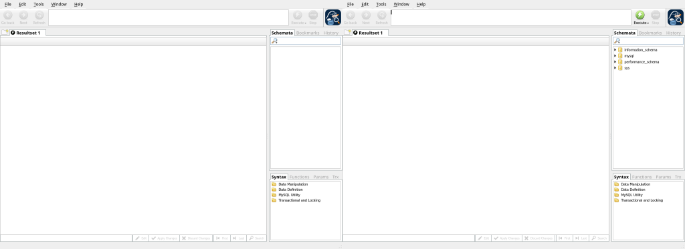
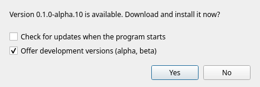
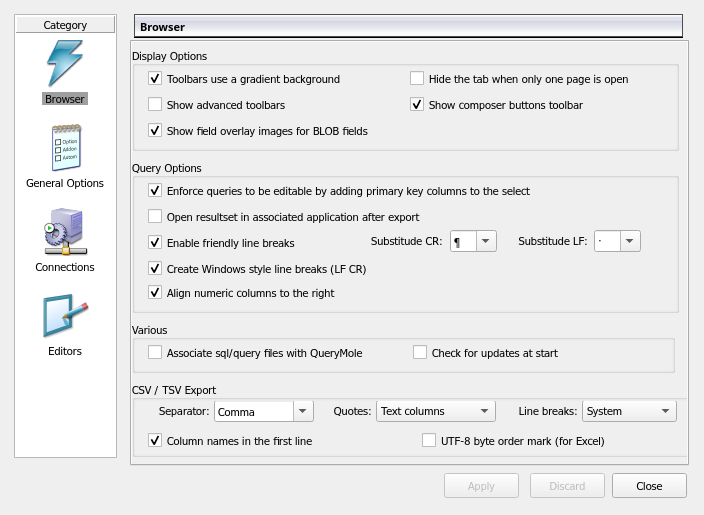

<!-- SPDX-License-Identifier: GPL-2.0-or-later -->
# ADR-0052 — Connect animation, starting without a connection, automatic update check

- Status: Proposed (built; screenshots below)
- Date: 2026-11-22
- Deciders: Harald Lapp (project owner)

## Context

Three wishes of the owner, each a change against the original (ADR-0047):

1. **No sign of progress while connecting.** The original plays an AVI progress bar in a 130 × 13 strip of the
   connect dialog; the port cannot play AVIs and left it empty (the main window plays the QueryMole animation
   since 0.1.0-alpha.8). A connect can take up to the connect timeout (20 s).
2. **The program cannot be used without a connection.** "Cancel" in the connect dialog at start ends the program,
   as in the original. The original also has a hidden "Skip" (hold Ctrl), taken over from MySQL Administrator,
   which ends the Query Browser too. So without a reachable server there is no way to the menu, not even to
   Help > Check for Updates. The main window itself knows the state without a connection: "Reconnect" reads
   "Connect" then.
3. **Updates are only found by hand.** Help > Check for Updates is the only way (ADR-0018, ADR-0037); the release
   notes promise that nothing is checked or downloaded unless the user chooses it. Which releases are offered follows
   the running version: a pre-release (alpha, beta) is offered newer pre-releases too, a release only releases.

## Decision

1. **Connect animation:** while the connect dialog connects, the QueryMole icon in its banner (top right) is
   animated, as the busy indicator of the main window is. `tools/make_branding.sh` writes a strip whose frames are
   the banner's corner with the animated icon in it (so the banner's gradient stays), linked as
   `querymole_connect_busy`; a `TAnimate` over that corner plays it while connecting and is hidden otherwise. The
   original's empty progress strip stays empty.
2. **Cancel opens the program without a connection:** at start, "Cancel" (and the hidden "Skip") open the main
   window without a connection instead of ending the program; File > Connect ("Connect" in the menu where
   "Reconnect" was) connects later, and Help > Check for Updates works. Closing the connect dialog that a
   connection made later opens behaves as before. Parts of the window that need a server (schema tree, help
   from the server) stay empty until then.
3. **Automatic update check, opt-in:**
   - a setting "Check for updates when the program starts" (off by default), in the options (Browser, "Various",
     the free half next to "Associate ...") and as a check box in the update dialogs;
   - once, at the first start of a release that has this feature, the program asks whether it may check
     automatically; the answer is stored and can be changed in the options;
   - when on, the program checks in the background after start and says nothing unless there is a newer version;
     then it asks as Help > Check for Updates does (download and install, or not). Nothing is downloaded without
     that answer. Errors of the automatic check are not shown (the menu entry still reports them);
   - a setting "Offer development versions (alpha, beta)", as a check box in the update dialogs (the options pages
     have no room left for it): on by default in a pre-release, off in a release, as the rule is now; turning it off
     in a pre-release offers only releases (none exist yet).
   - The settings are stored in the program's options file; earlier releases ignore them.

## Screenshots

Built version, Qt6: the connect dialog's banner while connecting (right) next to the still one (left); the program
started without a connection and after File > Connect; the update question; the Browser options page.

 

## Consequences

Positive:
- A visible sign that the connect dialog is working.
- The program can be started, configured and updated without a reachable server.
- Users who want it learn about new versions without looking; nobody is contacted without consent.

Negative:
- Cancel no longer ends the program at start; a user who used it to quit closes the window instead.
- The main window without a connection has empty parts; the menus that need a server report the missing
  connection.
- One more question at the first start of the release that brings the setting.
- The automatic check contacts GitHub at every start when it is on (as the menu entry does).

## Alternatives considered

- **The animation in the original's progress strip:** 13 pixels high, too small for the icon.
- **Only "Skip" (Ctrl) opens without a connection:** keeps Cancel as in the original, but the way stays hidden;
  the owner chose the visible one.
- **Automatic check on by default:** breaks the promise that nothing is checked without the user's choice; the
  owner chose off, with one question.

## Related

- ADR-0047 (features after parity), ADR-0018 and ADR-0037 (update check, feed and pre-release rule), ADR-0030
  (QueryMole artwork; the busy animation).
