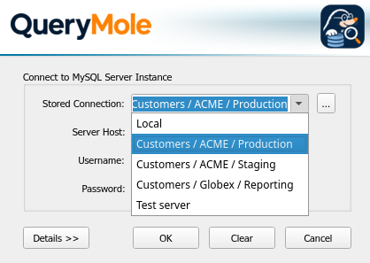
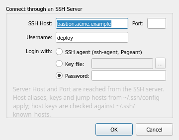

<!-- SPDX-License-Identifier: GPL-2.0-or-later -->
# ADR-0053 — Groups in the connect dialog's list, and the stored SSH password

- Status: Proposed (built; screenshots below)
- Date: 2026-11-22
- Deciders: Harald Lapp (project owner)

## Context

Two loose ends of earlier decisions:

1. **Groups in the connect dialog.** ADR-0051 put stored connections into groups (`storage_path`, folders in the tree
   of Options > Connections) and left the connect dialog's "Stored Connection" list as it was: names only, in file
   order. With groups, connections of the same name in different groups (`Customers/ACME` and `Customers/Globex`
   both with a "Production") look the same there, and the order does not follow the groups. The dialog uses the
   text of that box as the connection's name when it stores the connection after a connect, so the group could
   not simply be put into the text.
2. **The SSH password.** ADR-0048 decided that SSH passwords may be stored as the existing password storage setting
   allows (Options > General, "Store passwords"), but the SSH Tunnel dialog had no place to enter one; the
   password was asked for at each connect (and kept in memory for that session).

## Decision

1. **The list shows the group in front of the name**: "Customers / ACME / Production" for a connection in group
   `Customers/ACME`, the name alone for one without a group. The entries are in the order of the Connections tree
   of the options (depth first, each group where its first connection is in the file, connections in file order
   within their group), so a user who never makes a group sees the list as before. The selected entry shows the
   same text in the box. When the dialog stores the connection, the name is taken from the selected stored
   connection, not from the text, so the group never becomes part of the name; a text typed by the user that is no
   entry stays the name, as before.
2. **The SSH Tunnel dialog has a password field** next to "Password:", as "Key file:" has its file field, enabled
   when "Password" is chosen. The password is kept as the advanced option `SSH_PASSWORD`; the backend's connection
   file code (`myx_xml_user_connections.c`) stores it as it stores the connection's password (plain text, obscured
   or, on Windows, DPAPI) and leaves it out when passwords are not stored, and decodes it when loading. An empty
   field keeps the previous behaviour: the password is asked for when connecting. A password typed at that question
   in the current session is used before the stored one (so a stored password that stopped working is asked for
   once, not at each reconnect).

## Screenshots

Built version, Qt6: the connect dialog's list with connections in the groups `Customers/ACME` and `Customers/Globex`
and two without a group; the SSH Tunnel dialog with the password field.

 

Checked: `tests/test_connection_groups.pas` stores a connection with `SSH_PASSWORD` obscured (the password is not in
the file, it comes back on loading) and without stored passwords (the entry is gone, the other `SSH_*` entries stay);
`--selftest-dialog` connects with a stored connection in a group selected and the file keeps its name and group.

## Consequences

Positive:
- Connections in groups can be told apart and are found where the connection manager shows them.
- A tunnel with a password login connects without a question, for users who store passwords anyway.

Negative:
- Long group paths make the entries long; the box is as narrow as in the original and cuts the text (the list
  itself is as wide as it needs).
- The SSH password is stored as weakly as the connection's password: "Obscured" is no encryption. A key or the agent
  stays the better login; the dialog does not say so.
- Earlier releases (0.1.0-alpha.8 and 9) keep `SSH_PASSWORD` in the form it was stored in when they save the file;
  if the password storage type is changed in such a release, the entry no longer decodes and the password is asked
  for again.

## Alternatives considered

- **Group headers as entries of their own** (not selectable, connections indented below them): a combo box of the
  LCL cannot have unselectable entries on all widgetsets; it would need an owner-drawn list.
- **The group after the name** ("Production (Customers/ACME)"): keeps the names aligned, but the list no longer reads
  as sorted by group.
- **Storing the password typed at the connect question** (with a check box "Remember" in the question): a second place
  that changes the stored connection from the connect path; the dialog field is where the other SSH settings are.
- **The key passphrase too**: the same mechanism would work (`SSH_PASSPHRASE`); left out until asked for, a stored
  passphrase next to the key file defeats much of its purpose.

## Related

- ADR-0051 — the groups (`storage_path`) and the connection manager; this is the step it left for later.
- ADR-0048 — the SSH tunnel and the rule that passwords follow the password storage setting.
- ADR-0047 — the rules for features after parity.
