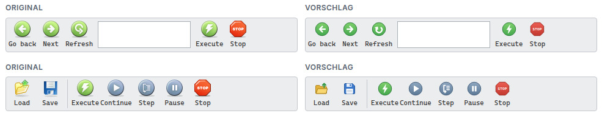
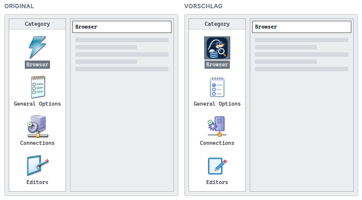
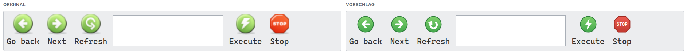

<!-- SPDX-License-Identifier: GPL-2.0-or-later -->
# ADR-0053 — A modern icon set, redrawn from the original's shapes, off by default

- Status: Proposed (design confirmed by the owner on 2026-11-22; mock-up below; not built)
- Date: 2026-11-22
- Deciders: Harald Lapp (project owner)

## Context

The original's pictures are bitmaps from 2005: about 240 PNG resources (150 in `mysqlqb.rc`, 93 in `mysqlcommon.rc`),
plus a few glyphs and image lists stored in the forms (about 16 image lists and 11 glyphs in `app/forms/*.lfm`). The toolbar
buttons are glossy discs with a specular highlight and a drop shadow, the options categories and message dialogs
48-pixel glass renderings. On current screens they look dated, and at 150–200 % scaling the system enlarges them and
they blur. There are no vector originals.

ADR-0009 deferred this until functional parity and sketched three steps: load every picture through `PNGTools`
(done), make the program DPI aware with whole-factor scaling of the classic icons, and "optional later" an extra icon
set rendered from SVG at build time, selectable as "modern icons", with the classic icons as default. Parity is
reached (ADR-0047), so step 3 needs its own decision under ADR-0047's rules (additive, off by default, in the
original's style). The owner asked for the icons, including the options dialog, to be modernised such that someone
who knows the MySQL Query Browser still recognises them.

A design proposal was made on the branch `design/modern-icons` (`docs/mockups/modern-icons/`, `proposal.html` built
by `make_proposal.py` from `proposal.template.html`, which holds the SVG drawings). It redraws about 50 of the most
visible pictures next to the originals. The owner confirmed the direction and asked for three corrections, now made:
the arrows in "Go back"/"Next" sat off centre, the arrowheads of Refresh, Undo and Redo looked wrong, and the bolt in
the options category "Browser" is the original's logo, which the QueryMole mole replaced everywhere else (ADR-0033).

## Decision

1. **Redraw, do not replace.** Every picture of the modern set is a new vector drawing of the same picture: same
   outline, same colour code, same motif, same place.
   - Round buttons stay round discs. Green means run and navigate (Go back, Next, Refresh, Execute, Undo, Redo,
     Explain, Compare), slate blue means script and transaction (Continue, Pause, the step buttons, Start transaction,
     Commit, Rollback); Stop stays a red octagon with the word "STOP".
   - The motifs stay: lightning bolt for Execute, folder with a green arrow, floppy disk, magnifier, yellow database
     cylinder, blue table and view windows, cyan and red diamonds for columns, a gold key for the primary key, speech
     bubbles for information and question, the yellow triangle and the red circle in the message dialogs.
   - **One exception:** where the bolt is the program's mark rather than "execute", the QueryMole icon takes its
     place, as ADR-0033 did for the application icon. That is the options category "Browser" (`options_querybrowser`):
     it shows `assets/querymole-icon.png` scaled to the size (its 304-pixel master stays sharp up to 200 %). The bolt
     on Execute, on the result set tab and in the browser perspective stays.
2. **Style:** flat surfaces with a light vertical gradient and a one-pixel darker outline instead of gloss and drop
   shadows; white glyphs with round line ends and one stroke width per size; glyphs a little larger than in the
   original so they read at 16 pixels. The pictures fill the same box as the originals (the toolbar discs, for
   example, are 24 pixels inside the original's 27 × 29, the space the shadow took).
3. **Vector masters, PNGs at build time** (ADR-0009, step 3): one SVG per picture under `assets/icons-modern/`, named
   after the classic resource (`query_back.svg`). A script `tools/make_modern_icons.sh` renders them to PNG at 100,
   125, 150 and 200 % into `app/images/modern/` (committed, like the output of `tools/make_branding.sh`, so the
   build and the CI need no SVG renderer), and `tools/build_resources.py` compiles them into a second resource file.
   No SVG library at run time. Pictures that are not icons (the About picture, the connect banner, the busy
   animations, textures and backgrounds) are not part of the set.
4. **Loading:** `PNGTools.LoadPNGImageFromResource` takes the modern resource for the current scale when the setting
   is on and one exists, and the classic picture otherwise. The fallback is a safety net, not a way to ship half a
   set: the setting is offered in a release only when every picture the user normally sees has a modern version.
   Image lists and glyphs stored in the forms are filled from resources by code when the setting is on.
5. **Setting, off by default:** "Use modern icons" in the options, page Browser, group "Display Options", in the free
   place right of "Show field overlay images for BLOB fields". Stored in the program's options file (older releases
   ignore it). It takes effect at the next start of the program; most pictures are loaded when their window is
   created. Off, the program shows the original's pictures, unchanged.
6. **Not decided here:**
   - HiDPI for the classic set (ADR-0009, step 2: DPI awareness and whole-factor scaling) stays its own step. Until
     the program is DPI aware, the modern set is used at 100 % only, which already removes the gloss; the scaled sizes
     take effect with step 2.
   - The SVG renderer for the script (`rsvg-convert` from librsvg is the candidate; none is installed in the
     distrobox yet). It is a build-time tool and only needs to be on the machine that regenerates the PNGs.
   - A free-standing drawing of the mole without its navy square, which would sit better among the free-standing
     category icons. It needs new artwork; the current mole is white on navy and would vanish on a white background.

## Mock-up

From the design proposal (`docs/mockups/modern-icons/proposal.html`; the page also switches between 100, 150 and
200 % and between enabled and disabled). Main and script toolbars, original left, proposal right:

The options dialog's categories, with the mole for "Browser":

The main toolbar at 200 %: the classic PNGs as the system enlarges them, the modern ones rendered for the size:

All pictures drawn so far, each next to its original: [all-icons.png](../mockups/modern-icons/all-icons.png).

## Consequences

Positive:
- A current look for those who want it, while every button keeps its place, colour and meaning; users of the
  original find their way without learning anything new.
- Sharp pictures at every scale once the program is DPI aware, with no run-time dependency and no start-up cost.
- The bolt as a product mark disappears from the last place the user sees it, in the modern set.
- Nothing changes for users who leave the setting off.

Negative / costs:
- Real drawing work: about 240 pictures, of which about 50 are drawn. Cursors, field overlays, tab close buttons,
  the data type icons, the transaction state icons and the disabled variants (the original has separate
  `_disabled` and `_down` pictures) are still to do. Until they are, the setting is not offered.
- Two picture sets to keep consistent: a new picture (for a new feature) needs both a classic-style bitmap and an SVG.
- A second resource file makes the program larger (four sizes of every picture; a few hundred kilobytes as PNG).
- Image lists and glyphs from the forms need code to be refilled, a place where the two sets can differ by mistake.
- Taking effect only after a restart is less convenient than switching at once.
- The mole on its navy square is heavier than the other category icons.
- Another visible deviation from the original (ADR-0001), though only when chosen.

## Alternatives considered

- **Replace the icons for everyone.** Rejected: ADR-0047 requires the original's screens when a feature is not
  chosen, and the owner's condition was that the original stays recognisable.
- **A standard icon theme (Breeze, Fluent, Material).** Rejected: different shapes and colours; someone who knows
  the Query Browser would have to relearn every button, and the colour code (green runs, red stops) would be lost.
- **Flatter, without gradients (plain fills).** Shown as a question in the proposal; the owner confirmed the
  version with a light gradient, which stays closer to the original's discs.
- **Automatic vectorising of the bitmaps.** Rejected in ADR-0009 already: pixel art traced to curves looks poor.
- **Render the SVGs at run time.** Rejected in ADR-0009: a library and start-up cost for no advantage.
- **Keep the bolt for "Browser" in the modern set.** Drawn as a variant; rejected by the owner because the bolt is
  the original's logo (ADR-0033).
- **Switch without a restart.** Possible but means reloading pictures in every open window, including the ones the
  forms hold; not worth it for a setting that is changed once.

## Related

- ADR-0009 — HiDPI and vector icons; this ADR decides its step 3 and supersedes that part. Step 2 stays open.
- ADR-0047 — features after parity: one ADR per visible change, additive, off by default.
- ADR-0033 — the QueryMole icon replaces the bolt; the reason for the one exception.
- ADR-0032 — origin and licence of the QueryMole artwork (`docs/licenses.md`).
- ADR-0001 — the original as blueprint.
